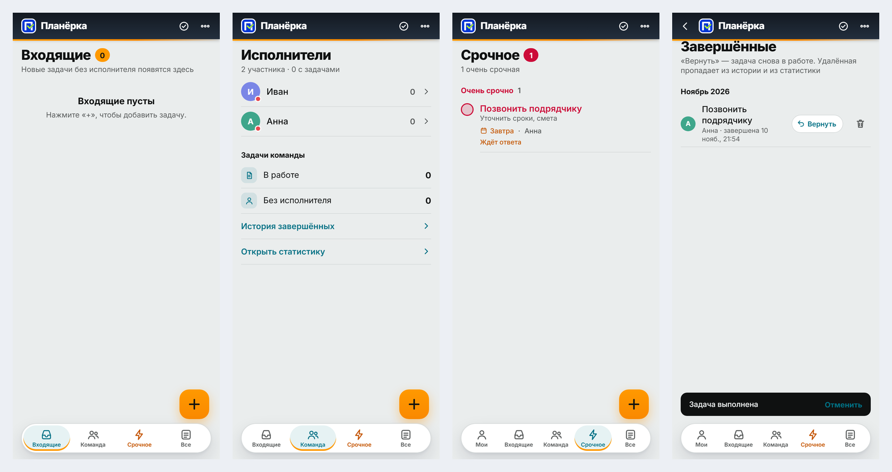

# Планёрка

**Общий список задач для небольшой команды** — входящие, исполнители, срочное, принятие и отказ с причиной,
уведомления на телефон, история и статистика. Веб-приложение (PWA) на PHP: без базы данных, без сторонних
библиотек, ставится на любой хостинг с PHP за несколько минут.

*Planerka — a tiny self-hosted team task board: PWA, plain PHP, JSON files instead of a database, Web Push
notifications without libraries. UI in Russian. MIT licensed.*



## Возможности

- **Вкладки:** «Мои» (личная ссылка), «Входящие» (задачи без исполнителя), «Команда» (кто чем занят и кто сейчас
  в приложении), «Срочное», «Все». Переключаются и свайпом.
- **Задача:** название, подробности (ссылки собираются отдельно), чеклист до 50 пунктов, срок, приоритет,
  исполнитель, номер контрагента с кнопками «Позвонить» и «WhatsApp» и выбором из контактов телефона.
- **Принять / Отказать:** назначенный исполнитель отвечает прямо в приложении; отказ — только с причиной,
  задача возвращается во «Входящие».
- **Уведомления на телефон (Web Push)** — о новой задаче, постановщику — о принятии и отказе; нажатие открывает
  нужную задачу. Своя реализация VAPID + aes128gcm, без библиотек.
- **Статистика** по кварталам и годам, **история** завершённых с возвратом в работу.
- **Работает без интернета:** правки копятся в очереди и уходят сами; страница — из кэша.
- Тёмная тема, установка «на экран Домой», окна над клавиатурой iPhone.

## Быстрый старт

```bash
git clone https://github.com/marcelkg-collab/planerka.git && cd planerka

# 1) адрес сайта: planerka/config.php → PL_SITE = 'https://ваш-домен'  (или переменная PLANERKA_SITE)
# 2) собрать страницу (Python 3.6+): вшивает стиль, шрифты и значки в planerka/app.html
python planerka/build.py

# 3) выложить папку planerka/ так, чтобы она открывалась по https://ваш-домен/planerka/
#    (Apache — уже настроен .htaccess; nginx — см. PLANERKA.md, раздел 5)

# 4) на сервере, от имени пользователя веб-сервера:
sudo -u www-data php planerka/admin.php init               # пустое хранилище, ключи
sudo -u www-data php planerka/admin.php password 'пароль'   # пароль входа
sudo -u www-data php planerka/admin.php add ivan 'Иван'     # исполнители
sudo -u www-data php planerka/admin.php owner ivan          # постановщик
sudo -u www-data php planerka/admin.php list                # личные ссылки
```

Попробовать на своём компьютере без веб-сервера:

```bash
python planerka/build.py
php planerka/admin.php init && php planerka/admin.php password 'test-123' && php planerka/admin.php add ivan 'Иван'
cd planerka && PLANERKA_SITE=http://127.0.0.1:8080 php -S 127.0.0.1:8080 index.php
# открыть http://127.0.0.1:8080/planerka/ и войти паролем test-123
```

**Требования:** PHP 7.0+ для веба; для уведомлений — PHP 7.3+ с openssl и curl в командной строке и HTTPS.

## Документация

Всё подробно — в [PLANERKA.md](PLANERKA.md): настройки, веб-серверы, команды администратора, что умеет
приложение, модель данных, API, проверка после установки.

Этот же файл — **полная копия приложения одним файлом**: весь код, картинки и шрифты внутри, с контрольными
суммами и распаковщиком (раздел 11). Его можно передать Claude Code или любому разработчику — по нему
приложение восстанавливается без этого репозитория.

## Файлы

| | |
|---|---|
| `planerka/config.php` | все настройки сервера |
| `planerka/index.php` | точка входа и маршруты |
| `planerka/api.php` | API и хранилище (JSON-файлы, блокировки, резервные копии) |
| `planerka/admin.php` | консоль администратора |
| `planerka/src.html`, `app.css` | интерфейс (чистый JS, без фреймворков) |
| `planerka/build.py` | сборка `app.html` |
| `planerka/sw.js` | сервис-воркер |
| `planerka/push-send.php`, `lib-webpush.php`, `gen-vapid.php` | уведомления |

## Лицензия

Код — [MIT](LICENSE): можно бесплатно использовать, менять и распространять, в том числе в коммерческих
проектах, сохраняя уведомление об авторстве. Шрифт Inter — SIL Open Font License 1.1
([planerka/fonts/OFL.txt](planerka/fonts/OFL.txt)).
